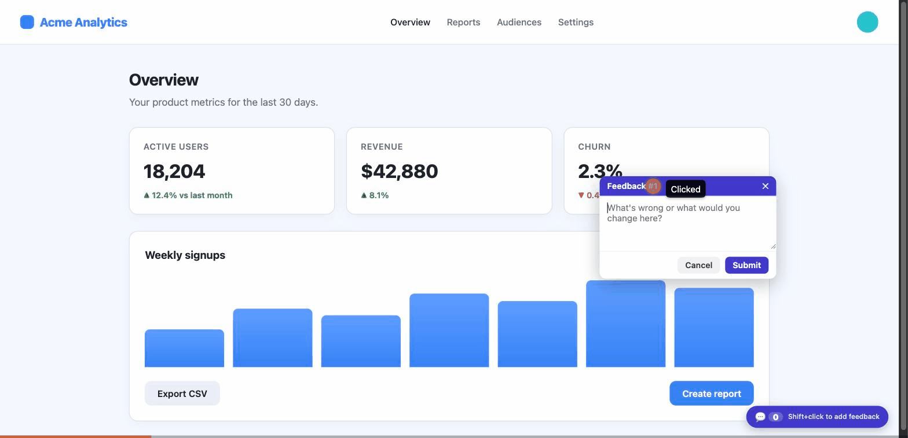

# web-feedback

A drop-in **visual feedback loop** between a running web app and Claude Code.

Hold **Shift** and click any spot on your app. Type what's wrong. The widget
screenshots the page, drops a numbered pin at the exact click point, and captures
the recent console logs and network requests. Everything is stored locally in SQLite,
where Claude reads each item — screenshot, the CSS selector you clicked, console errors,
failed requests — fixes it, and marks it resolved.

It's built for the inner loop of AI-assisted web development: you *see* a problem,
click it, and Claude has the pixel-accurate context to fix it.



## Highlights

- **Shift+click anywhere** → comment box → annotated screenshot + pin.
- **Modern-CSS-proof screenshots** — captures with [snapdom](https://github.com/zumerlab/snapdom), which renders through the browser, so `oklch()` / Tailwind v4 colors just work (html2canvas throws on these).
- **Console + network capture** — recent `console.*`, uncaught errors, and `fetch`/XHR requests (with status codes) travel with each report, so Claude debugs with the exact runtime state.
- **Per-URL pins** that persist across reloads and SPA navigation; click a pin to edit, resolve, or delete.
- **Works over app modals/sidebars** — the widget stays clickable even when the app sets `body { pointer-events: none }` (the Radix/Vaul/Headless UI pattern).
- **Dev-only** — a single dev-gated `<script>` tag; never ships to production.

## Requirements

- [Claude Code](https://docs.claude.com/en/docs/claude-code)
- **Node.js 18+** (the local collector uses `better-sqlite3`)

## Install

```bash
# add this marketplace, then install the plugin
claude plugin marketplace add 7th-Pillar-Infotech/web-feedback
claude plugin install web-feedback@seventh-pillar
```

That's it. The first time the skill runs it installs its own dependencies and starts a
local collector on `http://localhost:4765`.

## Usage

1. When you build or run **any** web project, ask Claude to embed the feedback widget
   (the skill does this automatically for dev builds). It's a single dev-only tag:
   ```html
   <!-- DEV ONLY -->
   <script src="http://localhost:4765/feedback-widget.js" defer></script>
   ```
   Optionally group feedback by project:
   ```html
   <script>window.FEEDBACK_CONFIG = { project: 'my-app' };</script>
   ```

2. In the browser, **hold Shift and click** any spot to leave feedback.

3. Back in Claude Code, say *"work on the feedback"* — Claude lists open items, reads each
   screenshot + console/network context, fixes it, and marks it resolved.

The widget is **never** included in production builds — gate it behind a
`NODE_ENV !== 'production'` / `import.meta.env.DEV` check.

## Where data lives

Feedback, screenshots, and the log are stored in a persistent per-user directory —
`~/.web-feedback/` by default — so they survive plugin updates. Override with
`FEEDBACK_HOME`, or `FEEDBACK_DB` / `FEEDBACK_DIR` individually.

## License

[MIT](./LICENSE) © 7th Pillar
